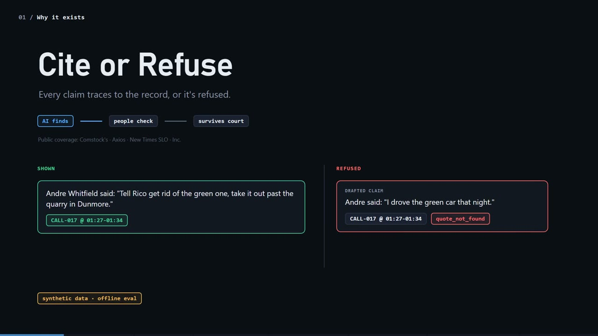

# Cite or Refuse

<!-- walkthrough-video -->
[](https://medhaja.github.io/cite-or-refuse/)

**[Watch the 3:38 walkthrough](https://medhaja.github.io/cite-or-refuse/)** (plays in your browser)
<!-- /walkthrough-video -->

**Run the demo (Python 3.10+, tested on 3.13):**

```bash
python -m pip install -r requirements.txt && python run.py
```

Then open http://127.0.0.1:8000. (`make demo` does the same thing.) No API key is needed.

> Independent prototype built from public information and synthetic data. Not affiliated with Closure.

---

## What it is

Ask a question about a synthetic cold case: 40 jail-call transcripts and 15 case-file documents. Each claim in the
answer comes with a verbatim quote and a citation to a transcript timestamp range (`CALL-017 @ 01:27-01:34`) or a
page and line range (`DOC-04 p.1 L6`). Before anything is shown, a deterministic verifier checks every citation. It
drops any claim it can't trace and lists it as **refused**, with the reason. An offline eval (`python eval.py`)
reports how often the system gets this right, and how many deliberately corrupted citations the verifier catches.

## The problem it targets (outside-in)

From public coverage, Closure's pitch is that the AI finds material and humans check it, and that the material still
has to survive cross-examination and court scrutiny
([Comstock's](https://www.comstocksmag.com/longreads/can-ai-solve-cold-cases-california-investigators-think-it-could-help),
[Axios](https://www.axios.com/2026/01/24/ai-police-evidence-cold-cases)). Comstock's says Closure points
investigators back to the source material, but it reports no error rates or testing. A local DA wants human
judgment kept in the loop
([New Times SLO](https://www.newtimesslo.com/a-slo-county-police-department-and-the-das-office-navigate-the-first-stages-of-ai/)).
In coverage of a competitor, a law professor asks
"[what auditing mechanisms exist](https://inc-1-smart-business-story.beehiiv.com/p/this-startup-raised-20-million-to-help-police-sift-through-evidence-can-its-ai-be-trusted)".

Closure's site describes a Zero Access Architecture ([closure-intel.com](https://www.closure-intel.com/)). My
reading, which is an assumption, is that engineers can't read production data to debug answer quality. If so,
quality has to be measured on data you're allowed to see, with a repeatable eval. One invented quote in a homicide
file is expensive, so this prototype makes "every sentence traces to the record" something you can check
mechanically and measure.

## What the demo shows (a two-minute script)

1. **Ask.** Click *"What did Andre tell Rico to do with the green car?"*. You get three verified claims: the line
   from a pair of near-duplicate calls (CALL-017 and CALL-018), plus the vehicle registration record. Each has the
   quote, a citation chip and a support score.
2. **Source viewer.** Click a chip. The full transcript opens with the cited line highlighted and every speaker
   labeled. Case files show page and line numbers.
3. **Refusals.** Tick *"Inject a fault"* and ask again. One drafted claim gets a wrong timestamp, an altered quote
   or a swapped speaker. It shows up in the red **Refused** panel with `bad_citation`, `quote_not_found` or
   `unsupported`, and the reason, and never reaches the answer.
4. **Unanswerable.** Ask *"What did the victim's brother say on the jail calls?"*. He never called, so the answer
   is **No traceable answer found**, and the retrieved chunks are listed for a human to check.
5. **Eval.** Open the Eval tab for metrics, targets and the questions with issues. Toggle *With fault injection* to
   compare: 9 of 9 corrupted claims are caught, and shown quote fidelity stays at 1.00.

Every `/ask` request is appended to `runs.jsonl` with the query, retrieved chunk IDs, claims, verdicts and latency.

## How it works

```
generator -> chunker (keeps citation metadata) -> BM25 index -> retriever -> answerer -> verifier -> FastAPI -> UI
                                                                    eval runner ---^ (same code path)
```

- **Data** (`cite_or_refuse/generator.py`, committed under `data/`): a seeded script, so every run is identical. It
  writes calls of 2-6 minutes with 2-3 speakers, partial names ("Dre", "Kev"), `[inaudible]` and `[crosstalk]`;
  case files with a typo'd date (`03/14/2008`) and conflicting witnesses (green car vs. blue pickup); the same
  phrase said by two people; near-duplicate calls; and a car referred to only by its color.
- **Chunks** keep `source_type`, `source_id`, `start_ts`/`end_ts` or `page`/`line_start`/`line_end`, `speaker` and
  `text`.
- **Retrieval** is BM25 (`rank_bm25`), with a source-type filter when the question says "on the calls" or "the
  report".
- **Answerer.** By default a deterministic extractive mock quotes the retrieved lines that cover the most of the
  question's IDF-weighted terms. It respects named people ("What did Tasha say…") and splits compound questions on
  ", and". If nothing clears the threshold it returns nothing. Optionally, an LLM drafts claims through LiteLLM. It
  picks lines by ID, and the citation itself is built from our metadata.
- **Verifier** (`cite_or_refuse/verifier.py`) is plain code. The first failing check wins:
  1. `bad_citation`: the call, timestamp range, document, page or lines don't exist.
  2. `quote_not_found`: the quote isn't verbatim in the cited span (only whitespace is normalized; case counts).
  3. `unsupported`: the cited speaker didn't say it; a number, date or name in the claim isn't in the span; or the
     claim's wording overlaps the span less than 0.6 (or, if enabled, an LLM judge says no).

  The model never gets the last word on whether a quote exists. String matching decides that.

## Eval results (mock mode, committed in `eval_report.json` / `eval_report_faults.json`)

```bash
python eval.py                  # clean run
python eval.py --inject-faults  # also corrupt 20% of drafted claims
```

| Metric | Clean | With 20% faults | Target |
|---|---|---|---|
| Retrieval recall@5 | 1.00 | 1.00 | ≥ 0.85 |
| Quote fidelity of shown claims | 1.00 | 1.00 | = 1.0 |
| Refusal on unanswerable questions (5) | 1.00 | 1.00 | ≥ 0.8 |
| False refusals on answerable questions (25) | 0.00 | 0.20* | ≤ 0.15 |
| Corrupted claims caught | n/a | 9 / 9 | ≥ 95% |
| Citation precision (shown claims citing a gold span) | 0.68 | 0.63 | — |
| Gold evidence covered by shown claims | 0.94 | 0.66 | — |

\* With faults injected, refusing a corrupted claim is the correct outcome even when it was the only answer, so the
false-refusal target applies to the clean run only. No clean claim was wrongly refused.

**Read these numbers with care.** I wrote the gold questions and the synthetic data together, so retrieval is easy
and the clean numbers are optimistic. The informative parts are the failures. Citation precision is 0.68 because
the lexical mock also quotes related but non-answering lines: for *"What vehicle did Paul Ortiz describe?"* it
quotes "A vehicle came out of the lot…" instead of "blue pickup truck". And the fault-injection catch rate shows
the verifier doing its job. None of this says anything about Closure's product.

## Optional LLM mode

```bash
python -m pip install -r requirements-llm.txt
cp .env.example .env    # set COR_LLM_MODEL (any LiteLLM model string) and the provider key
python run.py           # UI header shows the model; python eval.py writes the same report for comparison
```

`COR_LLM_JUDGE=1` lets the LLM judge entailment instead of lexical overlap. Citation checks, verbatim quote matching
and number/name checks stay deterministic. If the LLM call fails, the app falls back to the mock and says so in the
`mode` field. LLM mode is covered by unit tests with a stubbed model. I haven't benchmarked it against a live model
here.

## Tests

```bash
python -m pytest -q
```

46 tests. They check that a quote not in its span is always refused; that bad timestamps, pages and lines are
always refused; that a swapped speaker or a wrong number is `unsupported`; that every fault type is caught on every
drafted claim; that mock mode and the generator are deterministic; the API schema and logging; the eval targets;
and LLM-mode parsing and fallback with a fake model.

## Layout

```
run.py                  one-command demo        eval.py             eval CLI
cite_or_refuse/         generator, corpus (chunker + citation resolver), retriever, answerer,
                        verifier, faults, pipeline, evaluation, llm, app (FastAPI)
static/index.html       the UI (no build step)  data/               committed synthetic case
tests/                  pytest suite
```

## Limitations

- Synthetic transcripts are much cleaner than real jail calls. ASR errors would break strict verbatim matching. A
  real system would need fuzzy matching against an audio-aligned transcript, and a policy for how close is close
  enough.
- The lexical support check misses paraphrase and can be fooled by a claim that reuses the span's words with a
  different meaning. The optional LLM judge helps, but it's a judgment call: refuse more, or show with a warning?
- The mock answerer is lexical. It answers compound questions only when they're phrased with ", and", and it
  sometimes quotes a related line instead of the answer.
- The verifier checks that each claim traces to the record, not that the answer is complete or that the record is
  true. Conflicting witnesses are both shown; nothing reconciles them.
- Thirty gold questions written by the same person as the data is a smoke test, not a benchmark.
- No audio, OCR, auth, multi-case search or deployment hardening. This is not production software.

## Next steps

- Dense retrieval (e.g. FAISS) alongside BM25, scored by the same recall@5.
- Run the same eval in LLM mode with two models and diff the reports, so a model or prompt change shows up as a
  number before it ships.
- Fuzzy, timestamp-aware quote matching for ASR output, tested with injected transcription noise.
- Grow the gold set, written by someone other than the data author, and track the metrics in CI.

---

Independent prototype built from public information and synthetic data. Not affiliated with Closure.
